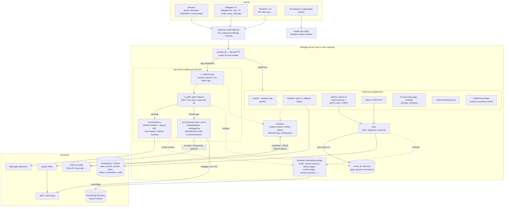
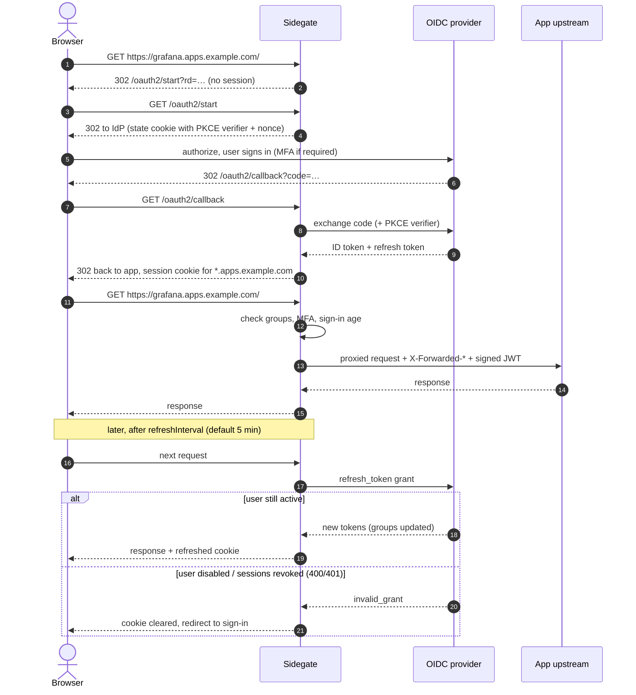
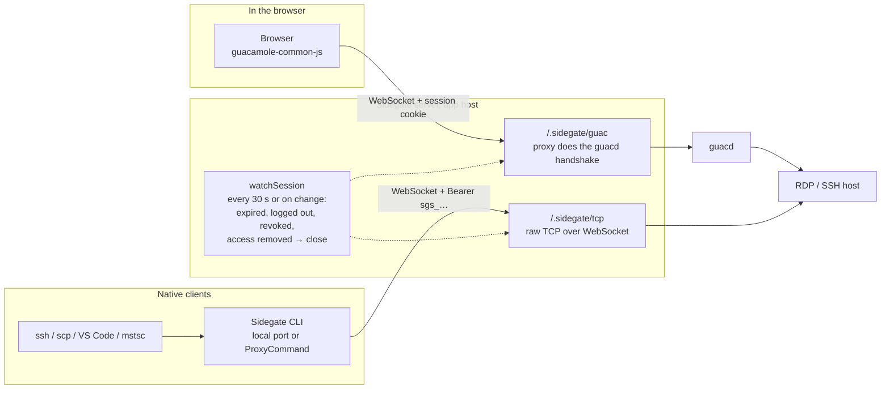

# Architecture

How Sidegate is built. User documentation is in the [README](README.md).

## Components

Sessions live in encrypted cookies, so replicas share nothing but the
database. Each replica keeps apps, groups and revocations in memory and polls
the database revision every 5 s.

## Sign-in and session revalidation

## Remote access (RDP / SSH)

